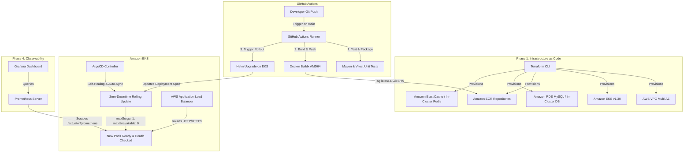
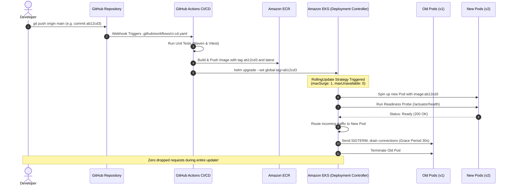

# Complete End-to-End Enterprise Deployment Guide
### Cloud-Native Retail Platform on Amazon EKS, ECR, Terraform, Helm, ArgoCD, Prometheus, Grafana & GitHub Actions

---

## 1. Architectural Blueprint & Automated Workflow

This guide covers the production deployment of the Cloud-Native Retail Platform on **Amazon Web Services (AWS)**. It covers infrastructure provisioning, automated CI/CD pipelines, GitOps synchronization, zero-downtime rolling updates, and monitoring.



---

## 2. Prerequisites & Local Tooling

Ensure the following CLIs are installed and configured on your machine (or management workstation):

```bash
# Verify tooling versions
aws --version          # AWS CLI v2.x
terraform version      # Terraform v1.8+
kubectl version --client # Kubectl v1.30+
helm version           # Helm v3.14+
docker --version       # Docker Engine v24+
```

### AWS Authentication
Authenticate your terminal with administrator credentials:
```bash
aws configure
# Enter AWS Access Key ID, Secret Access Key, Region (us-east-1), Output format (json)

# Confirm identity
aws sts get-caller-identity
```

---

## 3. Phase 1: Provision Cloud Infrastructure with Terraform

The `terraform/` directory defines the entire AWS cloud footprint:
- **Multi-AZ VPC** (`10.0.0.0/16`) across 2 Availability Zones with public/private subnets and NAT Gateways.
- **Amazon EKS Managed Cluster** (v1.30) with managed node groups (`t3.medium`).
- **Amazon ECR Repositories** for all microservices.
- **Security Groups** and IAM OIDC Provider for Kubernetes Service Accounts (IRSA).

### Step-by-Step Execution:
```bash
cd /Users/samir/ecom/terraform

# 1. Initialize Terraform plugins
terraform init

# 2. Plan and validate infrastructure changes
terraform plan -out=tfplan

# 3. Apply infrastructure to AWS (takes ~12-15 minutes)
terraform apply tfplan

# 4. Save and inspect Terraform outputs
terraform output
```

Save the exported output values:
- `eks_cluster_name` (e.g., `retail-platform-cluster`)
- `ecr_repository_urls`
- `vpc_id`

---

## 4. Phase 2: Connect Kubectl to Amazon EKS

Configure your local `kubectl` to communicate with the newly provisioned EKS cluster:

```bash
REGION="us-east-1"
CLUSTER_NAME="retail-platform-cluster"

aws eks update-kubeconfig --name "${CLUSTER_NAME}" --region "${REGION}"

# Verify cluster connectivity and worker nodes
kubectl get nodes -o wide
```

Create the application namespace:
```bash
kubectl create namespace retail-system
```

---

## 5. Phase 3: Build & Push Production Images to Amazon ECR

Build all 5 microservices for the `linux/amd64` architecture (matching EKS worker nodes) and push them to ECR:

```bash
cd /Users/samir/ecom

# Fetch your AWS Account ID
ACCOUNT_ID=$(aws sts get-caller-identity --query Account --output text)
ECR_REGISTRY="${ACCOUNT_ID}.dkr.ecr.${REGION}.amazonaws.com"

# Authenticate Docker daemon to Amazon ECR
aws ecr get-login-password --region "${REGION}" | docker login --username AWS --password-stdin "${ECR_REGISTRY}"

# Ensure ECR repositories exist
SERVICES=("retail/api-gateway" "retail/product-service" "retail/cart-service" "retail/order-service" "retail/frontend")
for repo in "${SERVICES[@]}"; do
  aws ecr describe-repositories --repository-names "${repo}" --region "${REGION}" >/dev/null 2>&1 || \
    aws ecr create-repository --repository-name "${repo}" --region "${REGION}"
done

# Build and Push using the automated helper script
chmod +x ./scripts/build-and-push-ecr.sh
./scripts/build-and-push-ecr.sh
```

---

## 6. Phase 4: Deploy AWS Load Balancer Controller (ALB Ingress)

The AWS Load Balancer Controller manages AWS Application Load Balancers for Kubernetes `Ingress` resources:

```bash
# 1. Associate IAM OIDC Provider with your EKS cluster
eksctl utils associate-iam-oidc-provider --cluster "${CLUSTER_NAME}" --region "${REGION}" --approve

# 2. Create IAM Policy for AWS Load Balancer Controller
curl -fsSL -o iam_policy.json https://raw.githubusercontent.com/kubernetes-sigs/aws-load-balancer-controller/v2.7.2/docs/install/iam_policy.json
aws iam create-policy --policy-name AWSLoadBalancerControllerIAMPolicy --policy-document file://iam_policy.json || true

# 3. Create ServiceAccount with IRSA
eksctl create iamserviceaccount \
  --cluster="${CLUSTER_NAME}" \
  --namespace=kube-system \
  --name=aws-load-balancer-controller \
  --role-name="AmazonEKSLoadBalancerControllerRole" \
  --attach-policy-arn="arn:aws:iam::${ACCOUNT_ID}:policy/AWSLoadBalancerControllerIAMPolicy" \
  --approve

# 4. Install AWS Load Balancer Controller via Helm
helm repo add eks https://aws.github.io/eks-charts
helm repo update eks

helm install aws-load-balancer-controller eks/aws-load-balancer-controller \
  -n kube-system \
  --set clusterName="${CLUSTER_NAME}" \
  --set serviceAccount.create=false \
  --set serviceAccount.name=aws-load-balancer-controller
```

---

## 7. Phase 5: Deploy Microservices via Helm

Deploy the complete application using the Helm chart located at `helm/retail-platform/`:

```bash
cd /Users/samir/ecom

GIT_SHA=$(git rev-parse --short HEAD)

# Install or upgrade the release on Amazon EKS
helm upgrade --install retail-platform ./helm/retail-platform \
  --namespace retail-system \
  --create-namespace \
  --set global.ecrRegistry="${ECR_REGISTRY}" \
  --set global.tag="latest" \
  --set ingress.enabled=true \
  --wait \
  --timeout 10m
```

### Verify Deployment:
```bash
# Check status of all pods and services
kubectl get pods,svc,pvc,ingress -n retail-system -o wide
```
Wait 2–3 minutes for the AWS Application Load Balancer to provision. Retrieve your public ALB DNS:
```bash
kubectl get ingress -n retail-system -o jsonpath="{.items[0].status.loadBalancer.ingress[0].hostname}"
echo ""
```

---

## 8. Phase 6: Deploy Monitoring (Prometheus & Grafana)

The platform includes Prometheus metrics scraping on `/actuator/prometheus` and pre-built Grafana dashboards.

### Step 1: Deploy Manifests
```bash
kubectl apply -f k8s/monitoring.yaml
```

### Step 2: Access Grafana & Prometheus
```bash
# Expose Grafana on port 3001
kubectl port-forward --address 0.0.0.0 svc/grafana 3001:3000 -n retail-system > /dev/null 2>&1 &

# Expose Prometheus on port 9090
kubectl port-forward --address 0.0.0.0 svc/prometheus 9090:9090 -n retail-system > /dev/null 2>&1 &
```

### Step 3: Configure Grafana
1. Open `http://<HOST_IP>:3001` (Credentials: `admin` / `admin`).
2. Add Prometheus Datasource: URL `http://prometheus:9090`.
3. Import the pre-built dashboard:
   - Go to **Dashboards -> Import** -> Paste contents of [`grafana/provisioning/dashboards/retail-microservices-dashboard.json`](file:///Users/samir/ecom/grafana/provisioning/dashboards/retail-microservices-dashboard.json).

---

## 9. Phase 7: Setup GitOps with ArgoCD

ArgoCD maintains desired cluster state synchronized with your Git repository.

### Step 1: Install ArgoCD on EKS
```bash
kubectl create namespace argocd
kubectl apply -n argocd -f https://raw.githubusercontent.com/argoproj/argo-cd/stable/manifests/install.yaml
kubectl wait --namespace argocd --for=condition=ready pod -l app.kubernetes.io/name=argocd-server --timeout=180s
```

### Step 2: Retrieve Admin Password
```bash
kubectl -n argocd get secret argocd-initial-admin-secret -o jsonpath="{.data.password}" | base64 -d
echo ""
```

### Step 3: Deploy GitOps Application
Apply the ArgoCD Application manifest:
```bash
kubectl apply -f argocd/application.yaml
```

---

## 10. Phase 8: Automated Rolling Updates on Code Changes

A primary requirement is that **any code change committed to Git must automatically build, push, and roll out to the cluster with ZERO DOWNTIME**.

### How the Automated Rolling Update Works:



### 1. Rolling Update Configuration in Helm
Each Deployment template in [`helm/retail-platform/templates/all-services.yaml`](file:///Users/samir/ecom/helm/retail-platform/templates/all-services.yaml) defines:

```yaml
strategy:
  type: RollingUpdate
  rollingUpdate:
    maxSurge: 1          # Spin up 1 new container BEFORE terminating an old one
    maxUnavailable: 0    # Never allow available pods to drop below replica count
```

### 2. Readiness Probes Prevent Premature Traffic Routing
Traffic is never shifted to a newly started container until Spring Boot passes its health check:
```yaml
readinessProbe:
  httpGet:
    path: /actuator/health
    port: 8081
  initialDelaySeconds: 25
  periodSeconds: 10
```

### 3. Required GitHub Repository Secrets
Ensure these 3 secrets are configured in **GitHub Repository -> Settings -> Secrets and variables -> Actions**:
1. `AWS_ACCESS_KEY_ID`
2. `AWS_SECRET_ACCESS_KEY`
3. `AWS_ACCOUNT_ID`

### 4. Testing the Live Rolling Update Flow:
Make an edit (e.g., in [`frontend/src/components/Hero.jsx`](file:///Users/samir/ecom/frontend/src/components/Hero.jsx)):
```bash
git add .
git commit -m "feat: updated hero banner"
git push origin main
```

Watch the rolling update happen in real-time in your terminal:
```bash
kubectl get pods -n retail-system -w
```
You will observe:
1. New pods start in `ContainerCreating` state alongside old pods.
2. New pods transition to `Running` and wait for readiness probes to pass (`1/1 Ready`).
3. Once ready, traffic shifts seamlessly, and old pods enter `Terminating` state.
4. **Result:** Zero downtime and zero 5xx HTTP errors during the release!

---

## 11. Phase 9: End-to-End Verification Runbook

### 1. Actuator Health Verification
```bash
ALB_URL=$(kubectl get ingress -n retail-system -o jsonpath="{.items[0].status.loadBalancer.ingress[0].hostname}")

curl -s "http://${ALB_URL}/actuator/health"
# Output: {"status":"UP"}
```

### 2. Complete End-to-End Shopping Flow Test
```bash
# 1. Fetch Products from Product Service via Gateway
curl -i "http://${ALB_URL}/api/products"

# 2. Add an item to Cart (Redis)
curl -i -X POST "http://${ALB_URL}/api/cart/1/items" \
  -H "Content-Type: application/json" \
  -d '{"productId": 1, "productName": "Wireless Headphones", "price": 99.99, "quantity": 1}'

# 3. Retrieve Cart
curl -i "http://${ALB_URL}/api/cart/1"

# 4. Checkout Order (Order Service & MySQL)
curl -i -X POST "http://${ALB_URL}/api/orders" \
  -H "Content-Type: application/json" \
  -d '{"customerId": 1, "shippingAddress": "100 Broadway, New York, NY", "paymentMethod": "CREDIT_CARD"}'
```

---

## 12. Phase 10: Teardown & Clean Up

To avoid unnecessary AWS cloud costs when finished testing:

```bash
# 1. Uninstall Helm applications
helm uninstall retail-platform -n retail-system
helm uninstall aws-load-balancer-controller -n kube-system

# 2. Delete ArgoCD and Monitoring resources
kubectl delete -f argocd/application.yaml || true
kubectl delete -f k8s/monitoring.yaml || true
kubectl delete namespace argocd retail-system || true

# 3. Destroy AWS infrastructure via Terraform
cd /Users/samir/ecom/terraform
terraform destroy -auto-approve
```

---

### Deployment Architecture Summary

| Component | Technology | Role |
|---|---|---|
| **IaC** | Terraform v1.8+ | VPC, EKS Cluster, ECR, IAM Roles |
| **Orchestration** | Amazon EKS v1.30 | Kubernetes Container Orchestration |
| **Registry** | Amazon ECR | Docker Container Image Storage |
| **Packaging** | Helm 3 | Templated Application Deployments |
| **CI/CD** | GitHub Actions | Automated Linting, Testing, Build & Push |
| **GitOps** | ArgoCD | Git-to-Cluster Synchronization |
| **Traffic Routing** | AWS ALB Controller | External HTTP/HTTPS Ingress |
| **Observability** | Prometheus & Grafana | Real-time Metrics, Alerts & Dashboards |
| **Zero-Downtime** | Kubernetes RollingUpdate | `maxSurge: 1`, `maxUnavailable: 0` with health checks |
